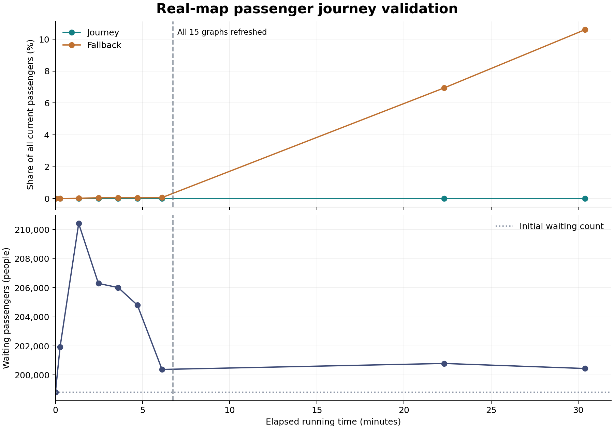

# Passenger journey measurements on 12 October 2026

The merged `jgrpp-ya` implementation at `cf2ae8e992` applied no timed Journey
routes during this real-map run. After
30 minutes 23 seconds of continuous simulation and a fresh recalculation of
every existing nontrivial CargoDist graph, 50,423 passengers were in Fallback
mode and 200,450 were waiting at stations. Waiting increased by 1,637 people
from the initial census.

## Measurement conditions

The input was `西日本旅客鉄道近畿、中国、山陽新幹線統括本.sav`
(26,219,444 bytes). A copy was migrated to the current save format before the
measured run. The original file's SHA-256 remained unchanged:
`ec93a76ebfeac52d55eccff2734bdf9fa3cdfb49021e5322e057bc048b744ba9`.

| Condition | Value |
|---|---|
| Source commit | `cf2ae8e992ec296f932c994646d20a804fd10491` |
| Build | MSVC 19.44, toolset 14.44, x64 Release |
| Game version | `jgrpp-ya-0.73.3+2-31-gcf2ae8e99-m` |
| Video / sound / music drivers | `win32` / `null` / `null` |
| Passenger CargoDist distribution | `2`, automatic |
| `linkgraph.passenger_od_assignment` | Enabled for the run; disabled in the input |
| `linkgraph.passenger_journey_routing` | Enabled for the run; disabled in the input |
| LinkGraph recalculation interval / time | 8 / 32 |
| Calendar day length | 74 state ticks |
| Largest passenger LinkGraph | Graph 1, cargo 0, 4,726 nodes |
| Autosaves / save on exit / threaded saves | Disabled |

The build used the cached dependencies with manifest installation disabled.
The existing local `vcpkg.json` change remained uncommitted; it accounts for
the version's dirty-tree suffix. The tested executable's SHA-256 is recorded
in the [run metadata](measurements/passenger-journey-2026-10-12/metadata.json).

Local copies of 115 `.grf`/`.tar` assets supplied the isolated run directory.
NewGRF compatibility/checksum warnings were accepted as authorized by the
user. The run also repeatedly reported vehicle-capacity changes outside
depots/refitting from JP+ Multiple Units and JP+ Private Companies v2.6.1.
These warnings remain a condition of this particular map and asset set.

## Simulation duration and graph refresh

All wall-clock times below are JST, UTC+09:00. The initial census at 04:08:00
preceded confirmation of the NewGRF unpause warning. Continuous simulation
started at 04:08:41 and continued until at least 04:39:04, for a conservative
1,823 seconds. The game was then paused. The final census was taken at
04:41:52 while paused, so the time spent collecting and saving the result
does not increase the reported simulation duration.

The calendar advanced from 117527-08-24 to 117528-03-11. State ticks increased
from 3,176,530,677 to 3,176,545,487, a difference of 14,810. Scaled ticks
increased from 3,010,931,579 to 3,010,946,389.

Refresh completion was confirmed at 04:15:26. All 15 original graphs with more
than one node published a job whose start tick was at least the initial scaled
tick, 3,010,931,579. The evidence is the `LinkGraphSchedule::JoinNext(): Finalised
graph` records, which identify graph/cargo, start, join and publication ticks.
Graph 1 completed one fresh publication; each of the other 14 completed eight
by the final census. Graph 9 has one node and requires no interstation flow
recalculation. Recurring jobs remain scheduled after publication; their worker
`completed` flags are recorded separately from these publication records.

The [graph completion CSV](measurements/passenger-journey-2026-10-12/linkgraph-completions.csv)
preserves the publication evidence, including older jobs that were excluded
from the fresh-job count.

## Passenger inventory results

The census completed without reaching its inspection limit. Journey and
Fallback percentages below are shares of current passenger **people**, across
station-available cargo and all vehicle-held cargo. Reserved cargo is already
vehicle-held and is counted once. Waiting is station-available plus
station-reserved cargo; reservations were zero at every sampled census.

| Metric | Initial census | Final census |
|---|---:|---:|
| All passenger holdings | 513,425 | 475,610 |
| Passengers with a known final destination | 0 | 116,097 |
| Legacy mode | 513,425 | 425,187 |
| Journey mode | 0 | 0 |
| Fallback mode | 0 | 50,423 |
| Journey share of all passengers | 0% | **0%** |
| Fallback share of all passengers | 0% | **10.6018%** |
| Journey share of known-destination passengers | n/a | 0% |
| Fallback share of known-destination passengers | n/a | **43.4318%** |
| Waiting at stations | 198,813 | **200,450** |
| Passengers marked deferred | 0 | 36,501 |

Waiting increased by 1,637 people, or 0.8234%. Legacy can include both passengers
without a final destination and known-destination passengers awaiting timed
planning. Deferred passengers overlap the mode counts and are not a fourth
routing mode. Inventory percentages describe the stock at the sampling instant;
they are not per-search success/failure probabilities. The different sizes of
the all-passenger and known-destination inventories explain their different
Fallback percentages.

| Elapsed simulation | Game calendar | Waiting | Fallback share of all passengers | Deferred |
|---|---|---:|---:|---:|
| Before unpause | 117527-08-24 | 198,813 | 0% | 0 |
| 00:16 | 117527-09-01 | 201,931 | 0% | 0 |
| 01:20 | 117527-10-01 | 210,417 | 0.0134% | 0 |
| 02:28 | 117527-11-01 | 206,296 | 0.0504% | 0 |
| 03:36 | 117527-12-01 | 206,014 | 0.0549% | 0 |
| 04:42 | 117528-01-01 | 204,809 | 0.0492% | 0 |
| 06:07 | 117528-02-01 | 200,385 | 0.0596% | 0 |
| 22:18 | 117528-03-01 | 200,795 | 6.9459% | 23,345 |
| At least 30:23, final paused census | 117528-03-11 | 200,450 | 10.6018% | 36,501 |

Journey remained zero at every census. The large passenger graph's fresh
publication occurred after the February sample; the March samples include
substantially more passengers with known destinations.



The [sample CSV](measurements/passenger-journey-2026-10-12/samples.csv) retains
unrounded values and separate simulation/wall-clock elapsed times. Its initial
negative elapsed value denotes the census taken before unpause. The final
simulation elapsed value is capped at the conservative pause time.

## Routing diagnostics and remaining constraints

The cumulative active diagnostic recorded **zero applied packets, zero applied
passengers and zero timed planner searches**. The final packet-mode inventory
was consistent with these counters: zero Journey packets and 26,847 Fallback
packets. The following are cumulative packet observations, so retries can count
the same packet repeatedly; they are not counts of distinct passengers.

| Diagnostic reason | Fallback observations | Deferred observations |
|---|---:|---:|
| `GraphMemory` | 33,325 | 75,927 |
| `PredictionIncomplete` | 2,275 | 0 |
| `SnapshotLimit` | 0 | 233,615 |
| `GraphWork` | 0 | 3 |
| All other reported reasons | 0 | 0 |

`GraphMemory` reports exhausted memory admission or globally limited graph
capture. The graph's `LimitReached` status also covers service/trip ceilings;
the diagnostic alone does not establish process RAM exhaustion. Prediction
uncertainty and incomplete capture prevent entry into timed planner searches.
The [active routing](passenger-journey-active.md) and
[service graph scaling](passenger-service-graph-scaling.md) documents describe
the completeness requirements, fallback policy and deterministic limits.

| Cumulative construction metric | Result |
|---|---:|
| Dynamic graph builds / static index hits | 36,201 / 26,430 |
| Mean / maximum graph construction time | 35.119 / 79.691 ms |
| Total graph construction time | 1,271.378708 seconds |
| Maximum graph/search time summed in one simulation tick | 824.149 ms |
| Peak retained graph / static index estimates | 20,166,424 / 897,388 bytes |
| Conservative graph envelope including index | 134,217,600 bytes, 128 MiB |
| Untimed OD fallback path searches | 136,617 |

These times and allocation estimates describe this one run. The tick metric
covers instrumented graph/search functions; whole-game tick time and process
RSS were not measured. Repeated GUI/GRF warnings can also affect wall-clock
progress. There was no paired inactive-mode baseline, so the waiting increase
cannot be attributed solely to Journey routing. Fresh CargoDist/OD publication
was confirmed, but successful timed Journey application remains unverified on
this map because every observed attempt failed or was deferred before search.

## Automated checks and retained evidence

Before the measured run, all **394 CTest entries** passed in 60.99 seconds.
The explicit passenger selection, including hidden performance fixtures,
passed **177 cases with 122,939 assertions**. The suite included production
save/load, disabled-mode behavior, GUI/diagnostic save-state purity, shadow
save comparisons and the AI/GameScript regressions. These checks validate
their fixtures; the real-map measurements above expose additional scale and
prediction constraints.

The committed evidence consists of the sample CSV, graph publication CSV,
[metadata](measurements/passenger-journey-2026-10-12/metadata.json), chart and
[final console extract](measurements/passenger-journey-2026-10-12/final-console.txt).
The extract preserves the inventory, cumulative reasons, construction counters
and final graph/job inventory. The console measurements used:

```text
getsysdate
getfulldate
passenger_journey_stats inventory
passenger_journey_stats total
dump_linkgraph_jobs
```

The original and migrated saves, full console log and final
`verified-result.sav` remain local under `build-real-map-journey-20261012/`.
The final save was written successfully after the paused census. Save files
and NewGRF assets are not part of this documentation commit.
