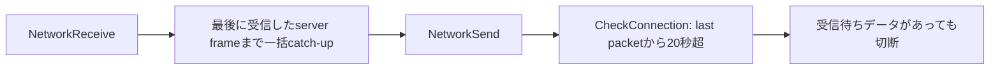

# Work admission: multiplayer disconnect cause separation

後続のユーザー方針により、全cache無効時の接続timeoutは[独立した受信fairness課題](passenger-network-receive-fairness-followup.md)として扱う。最新ベースでの通常cache有効の統合条件と結果は[2026-10-15の検証](passenger-query-work-admission-integration-2026-10-15.md)を参照。この原因分離の観測・失敗原本は保持する。

対象は `feat/passenger-query-work-admission` の製品実装 `c16da03990`、既存検証HEAD `91201edc79`。製品ソースとWork配分は変更せず、コピーしたnetwork.cpp / network_client.cpp / network_server.cpp / tcp.cppだけへ観測を追加した。タイムアウトの延長、sync頻度の低下、追い付きの途中yieldや人工pauseは行っていない。

## 分離した観測

受信タイムアウトまでの経過だけで原因を確定しない。サーバーのServerFrame受付、TCPの正の送信戻り値、クライアントの受信入口、追い付きbatchのbegin/end、ゲームスレッドとプロセスのCPU時間、切断前のFIONREADを同時に記録した。FIONREADはデータを消費せず、タイムアウトの判断には使わない。

同一WindowsホストのQPCを共通時系列に用いた。Microsoftは同ホストの別thread/process間でもQPCが一貫することを説明している。[QPC仕様](https://learn.microsoft.com/en-us/windows/win32/sysinfo/acquiring-high-resolution-time-stamps)。CPUはGetThreadTimes/GetProcessTimesのuser+kernel、100ns単位。サーバー送信は500msごとの累積値で、batch内の最初と最後のsampleの差だけを下限として集計した。ServerFrameをqueueしただけの数を送信成功数に置き換えていない。

観測ヘッダーはネットワークでエラー戻り値が出た直後のNetworkError取得を維持し、TCPの送受信・受付・検索結果を変更しない。CPU・wall時計は観測だけに使用する。共有ホストロック、実行前20秒の無競合、実行中5秒ごとの他ゲーム・ビルド監視を追加した。自分の3プロセスだけをowned PIDとして除外し、他プロセスを停止しない。

観測のファイルI/O・CPU時計取得費用は含まれるため、このCPU値を既存の性能ベンチマーク値へ再利用しない。以前のタイムアウトだけの観測でも24.697秒の切断を再現済みで、今回はその間の通信と処理を分離する試験と位置付ける。

## 競合なしの再現

入力Save SHAは `14d68c82911b9dcfc5ef7291e9697c5bbd67f44ffcc79d7575a144405edf6390`、実マップ16,384×4,096。MSVC x64 Release、assert ON、LTO OFF。サーバー1台・初期client1台・途中client1台、sync_frequency=1、CPU affinityは制限しない。両clientでpolicy / Departure Index / resident fallback / Scratchを無効化した。

[cold-1の時系列と集計](measurements/passenger-query-work-admission-2026-10-14/network-cause-review/cold-1/timeline-analysis.json)。初期clientのframe `1903 → 2255` の352frameを一括で追い付くbatchはwall 24.229420秒、ゲームthread CPU 23.468750秒（96.86%）、process CPU 47.078125秒だった。process CPUはworkerも含むためwallより大きくなりうる。

同じbatchの間、対応するサーバーsocketは少なくとも26,102 bytesをOSへ送信成功し、ServerFrameの観測は `2256 → 2677` まで進んだ。送信would-block増分は0。clientはこのbatch内で受信入口へ戻らず、終了直後の20秒監視でidle 24,229msと判定された。その直前のclient socketには26,784 bytesが待っていた。TCPはデータを届けており、serverが送信を止めたことを原因とする説明はこの再現に合わない。

これは**CPUを使う長い追い付き処理によるクライアントの受信飢餓**であり、受信がないと誤認して切断した経路を直接観測した。ゲームthreadはこの間のほぼ全時間をCPU実行に使っている。送信停止、単なるsocket queue不足、desync検出による切断とは区別できる。

## 対照と再現性

無競合の追加再現 [cold-3](measurements/passenger-query-work-admission-2026-10-14/network-cause-review/cold-3/timeline-analysis.json) でも、306frameの追い付き `1683 → 1989` にwall23.643850秒 / thread CPU22.796875秒（96.42%） / process CPU45.562500秒を使った。同期間のサーバー送信下限は23,808 bytes、clientのpendingは24,118 bytes。ServerFrameは `1992 → 2376` へ進み、送信would-block増分0、batch内の受信入口復帰0で、同じ20秒監視が切断した。

| 正式再現 | catch-up frame数 | wall秒 | game thread CPU秒 | CPU/wall | サーバー送信下限bytes | client pending bytes |
|---|---:|---:|---:|---:|---:|---:|
| cold-1 | 352 | 24.229420 | 23.468750 | 96.86% | 26,102 | 26,784 |
| cold-3 | 306 | 23.643850 | 22.796875 | 96.42% | 23,808 | 24,118 |

両再現の入力と観測バイナリSHAは一致し、競合監視記録は空。バイナリSHAは `61ec8ed6ecc052da65a5fa5268704a26e57b2a2ad0bd789c0f5e3b66c451da4b`。

同一観測バイナリの無競合 [warm-2対照](measurements/passenger-query-work-admission-2026-10-14/network-cause-review/warm-2/result.json) はpolicy / Departure Index / resident fallback / Scratchをすべて有効にした。途中参加後120秒を完了し、両clientは接続を維持した。最大catch-up batchは初期client0.380778秒 / 途中client0.400261秒で、受信入口の最大間隔は1.941671 / 1.987611秒（join/loadも含む）。受信タイムアウト・desync・assertはなかった。

serverはStateTicks `3176545487 → 3176548054` の2,567実tickを進行した。終点の3台は134,035 Packet・838,522 cargo単位・既知OD190,097単位・Journey12,646 Packet、全Packet保存対象フィールドと支払digestが一致し、支払検証も成功した。これはcache有効の対照であり、要求されたcache無効clientの合格として置き換えない。

最初のwarm試行も途中参加後120秒を終え、2台の接続維持・同tick Cargo一致を観測したが、途中で他の回帰テストが動いたためCPU比較の正式結果へ数えない。正式なcold-1 / cold-3 / warm-2と除外したcold-2 / warmの区別を、[集計と検証結果](measurements/passenger-query-work-admission-2026-10-14/network-cause-review/summary.json)に保存した。

2回目のcold試行では途中で他のMSVCビルドが開始した。205frame / wall22.293119秒、thread CPU15.703125秒、server送信下限15,624 bytes、pending16,182 bytesという同じ受信滞留を観測したが、CPU比較の正式結果から除外した。[競合記録](measurements/passenger-query-work-admission-2026-10-14/network-cause-review/cold-2/run-metadata.json)を保持し、無競合の反復へ数えない。

## 処理順序と対策の範囲

製品のNetworkGameLoopは、Receiveで得た最後のserver frameまでクライアントを一括で進め、その後のNetworkSend内でCheckConnectionを呼ぶ。長いbatchの途中にはNetworkReceiveがない。追い付き後も次のReceiveより先に20秒監視が走るため、既にsocketへ届いた新しいpacketを確認する前に切断できる。

このネットワーク製品コードは比較ベース `8a96044d40` と一致する。機構が既存であることと、新しいWork配分が発生頻度へ全く影響しないことは別であり、旧Admissionで同じnetwork CPU試験はまだしていない。本切断がdesync検出によるものではないことを確認したが、全条件の決定性が証明されたとは扱わない。

この比較は全cacheとScratchをまとめて有効／無効にしたため、どの派生構造の費用が支配的かは分離していない。2つの無競合再現で、通信データが到着済みであり、23〜24秒のbatchの96%以上がゲームthread CPU時間だったことを確認した。対照で長いbatchが消えたことは負荷との関係を支持するが、ネットワーク側の公平な受信復帰と計算量改善は別々に評価する。

対策は、決まったframe数で追い付き処理を区切って受信・socket進行へ戻る設計、追い付き後に到着済みデータを確認してから接続監視する処理順序、clientのCPU負荷軽減を別々に検討する。いずれもframe/command順序やsave状態を保つ検証が必要。探索をCPU時間で打ち切る変更や、タイムアウトを単純に延長して成功扱いにする変更は採用していない。現在の統合保留は維持する。
